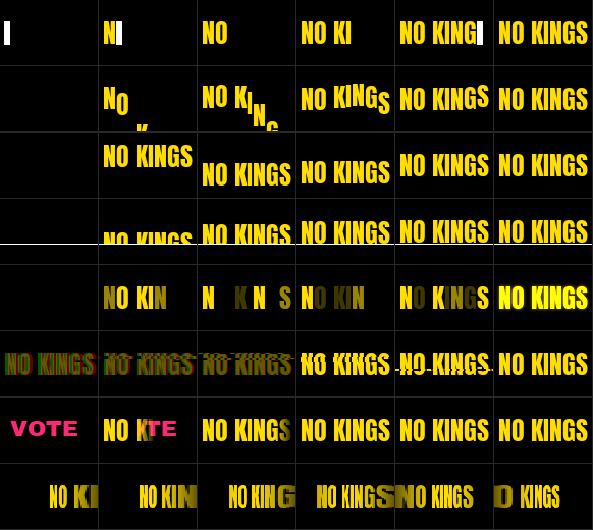

# Plan: text reveals and transitions

**Status:** researched and prototyped on 2026-10-17; not built.

## The request

`needs.txt` (lines 18–49) is a guide to text transitions on digital signs:
kinetic type (overshoot swing, letters staggered 30–60 ms apart, a matte
reveal), illumination (neon flicker and glow, glitch, a feathered wipe),
spatial distortion (a globe or fish-eye wrap, a typewriter reveal), and three
practices: asymmetric easing, motion blur, and high-contrast masking.

Protest shows **words to inform**; MatrixPrism is the place for generative,
music-driven art. So every effect here is judged by one test: can a passer-by
read the message sooner, or remember it better? Effects that only decorate
are lower priority.

## What the sign does today

| Guide technique | Today |
|---|---|
| Overshoot swing | Partly: `pow` and `zoom` overshoot, but the whole block moves as one |
| Staggered letters | No: text is drawn as one block mask, with no per-letter layout |
| Matte reveal | No |
| Neon flicker and glow | No (`flash` and `pulse` blink the whole block) |
| Glitch | No |
| Feathered wipe | No: slides and fades only |
| Globe or fish-eye wrap | No (`scroll` is flat) |
| Typewriter | No |
| Asymmetric easing | Partly: `pow`, `zoom`, and the impact transition ease; slides and fades are linear |
| Motion blur | Not needed: the diffuser already blurs motion |
| High-contrast masking | Yes, as the outline; a dark backing plate behind text would add to it |

## Prototypes

Eight effects were drawn at 96×64 with the sign's Impact font, a 2 px outline,
and per-letter placement (`font.getlength(text[:i])` gives each letter's x).
The sheet shows four frames of each, left to right through the reveal:

| Effect | What it does | Pi 4 ms/frame | Verdict |
|---|---|---|---|
| Typewriter | One letter per 70 ms, with a blinking cursor | 7.6 | Strong; the guide's pick for information |
| Letter rise | Letters rise 45 ms apart, 350 ms each, easeOutBack | 11.5 | Strong; the guide's 30–60 ms stagger |
| Drop-in | Letters fall from above and overshoot (easeOutBack, k=2.2) | 15.5 | Strong; the overshoot swing |
| Matte rise | Text rises out of a line, masked below it | 15.7 | Needs work: centre the text and fade the line out |
| Neon power-on | Letters flicker on at random until 0.75 s, then glow | 10.4 | Strong at night; reads as "LED sign" |
| Glitch in | Row slices shift and colour channels split, settling over 0.6 s | 0.6 | Good as a transition, too noisy as a reveal |
| Feathered wipe | Old message wiped to new behind a 20% soft band, easeOutCubic | 1.3 | Strong; better than a plain fade |
| Globe scroll | Scrolling text bent round a cylinder, shaded at the edges | 9.0 | Good; letters stay readable in the middle third |

All run inside the 33 ms frame budget at 30 fps. Per-letter drawing is most of
the cost; caching each letter's fill and outline masks per message cuts it,
since only positions change between frames.

Signs come in many sizes, and the cost grows with the pixel count: a 384×128
sign has eight times the pixels of this one. Timings must be measured again at
the largest size in use before choosing defaults.

## Design

1. **Reveal, a new message property.** A one-time entrance that plays before
   the message's ongoing Effect (scroll, pulse, and so on):
   `none`, `typewriter`, `letters_rise`, `drop_in`, `matte_rise`, `neon`.
   - `TextRenderer` gains per-letter layout from `layout_text` (each line's
     letters and their x positions) and a cache of letter masks.
   - Stagger and duration scale with the existing speed setting. The whole
     reveal is capped (about 1.5 s) so a long message does not take ages to
     appear: the per-letter delay shrinks to fit.
   - For scrolling messages, only `neon` and `none` apply; the others need the
     text to be still.
2. **Easing everywhere.** Slides and fades take easeOutCubic on entry. Exits
   take a quicker easeInCubic. This is the guide's asymmetric easing and costs
   nothing.
3. **New transitions** between playlist items, in `transitions.py`:
   - `wipe_left`, `wipe_right`, `wipe_up`, `wipe_down`: a feathered wipe;
   - `glitch`: about 0.4 s, kept short so text is unreadable only briefly;
   - `neon`: the old frame flickers and dims, then the new one snaps on.
4. **Globe** as a third scroll style, next to scroll left and right.
5. **Backing plate,** a style option: a dark rounded box behind the text, for
   messages over busy pictures.
6. **Previews and editor.** The message editor gets a Reveal picker, and the
   preview shows the reveal then the effect, drawn by the sign's renderer as
   now. Database change: one additive `reveal` column on messages.
7. **Any sign size.** Timings are in seconds and stay the same on every sign.
   Distances (drop height, matte line, glitch shift, glow radius) are
   fractions of the sign's height or multiples of `pixel_unit(size)`, never
   fixed pixels.
8. **Tests:** layout positions match `font.getlength`, every reveal ends on
   exactly the static frame, reveal time stays under the cap for long text,
   and every new transition starts on the old frame and ends on the new, at
   several sign sizes.

Later, if wanted: exit animations (letters fall away), and per-word rather than
per-letter staggering for long messages.

## Readability rules

- Every reveal ends on the same still frame as the message with no reveal,
  and holds it for the item's full duration; the reveal adds time, it does not
  take it from reading.
- No effect makes text unreadable for more than about half a second.
- Neon and glitch flicker. Keep them off by default and avoid rapid
  full-panel flashing (more than 3 a second), which can trigger photosensitive
  seizures.

## Decisions for the owner

- Should the reveal replay each time a message comes round in the playlist,
  or only the first time? Recommended: every time; it is what draws the eye.
- Which reveal should new messages default to? Recommended: `none`, keeping
  today's behaviour, with the picker one tap away.

## Effort

About a day: half for per-letter layout, caching, and the reveals; the rest
for easing, the three transitions, globe, the editor, and tests. Check the
reveals outdoors behind the diffuser before choosing defaults.
